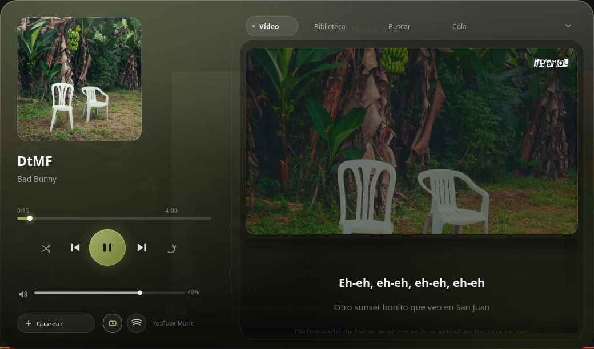
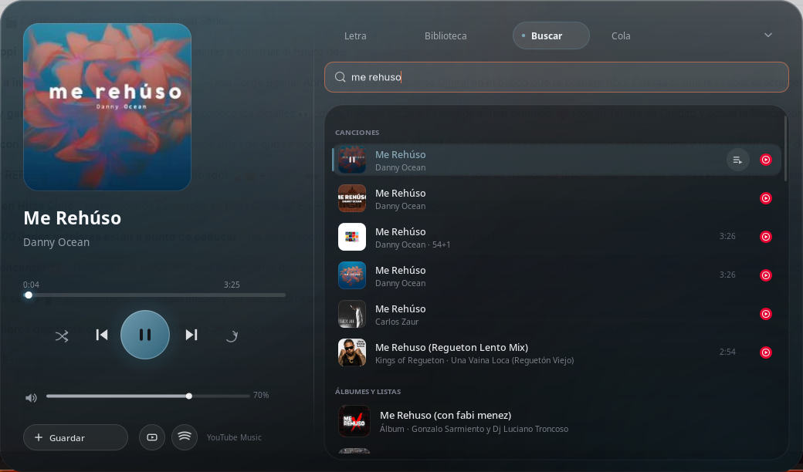

# Marmota Music

Reproductor de música nativo para Omarchy/Hyprland: una barra flotante tipo
*notch* en la parte inferior de la pantalla, con estética de vidrio, portada,
letras sincronizadas, vídeo dentro del notch y controles completos.
Busca y reproduce desde **YouTube Music** y **Spotify**.




- **Abrir/cerrar:** `Super + Shift + M` (o `marmota-music toggle`)
- **Instalar:** `./install.sh` (ver [Instalar](#instalar))
- Hecho en Rust + GTK4, pensado para gastar poco: ~1 % de CPU contraído.

## Uso

| Acción | Cómo |
| --- | --- |
| Abrir el notch | `Super + Shift + M` |
| Reproducir / pausar | clic en el botón central, o `Espacio` |
| Adelantar / retroceder 5 s | `←` / `→` |
| Volumen | arrastrar la barra, rueda del ratón, o `↑` / `↓` |
| Encoger a la píldora mini | clic en el chevron, `Esc` |
| Letras / biblioteca / buscar / cola | pestañas de la derecha |
| Ver el videoclip dentro del notch | botón ▶▭ junto a *Guardar*, o `v` |
| Guardar en la biblioteca | botón *Guardar* |
| Crear lista | Biblioteca → *Nueva lista* |
| Importar tus listas de YouTube Music | Biblioteca → *Importar de YouTube Music* (usa la sesión del navegador; se configura en `~/.config/marmota-music/config.json`, clave `cookies_browser`) |
| Reproducir a continuación / quitar de la cola | botones que aparecen al pasar el ratón por una fila |

La píldora mini muestra la línea actual de la letra y la siguiente, además de
los controles y una línea de progreso en el borde superior.

El notch aparece siempre en el monitor que tiene el foco y se escala según su
altura lógica: 1040×612 en una pantalla 1440p, 832×490 en el panel del portátil
(1080p a 1.25×). Al cambiar de monitor se vuelve a mapear la superficie.

## Cómo está hecho

| Pieza | Implementación |
| --- | --- |
| Ventana | GTK4 + `gtk4-layer-shell` (capa overlay, anclada abajo) |
| Dibujo | Cairo + Pango, todo pintado a mano (vidrio, iconos, texto) |
| Audio y vídeo | libmpv embebido (render por software al notch) con IPC JSON por socket |
| Búsqueda / inicio / álbumes / listas / radio | API InnerTube de YouTube Music (`src/ytm.rs`); yt-dlp como respaldo y para listas privadas |
| Letras | LRCLIB (exacta y búsqueda) y NetEase de respaldo; solo se cachean las sincronizadas |
| Portadas | descargadas y cacheadas en `~/.cache/marmota-music/art/` |
| Biblioteca / listas | SQLite (`~/.local/share/marmota-music/marmota-music.db`) |
| Control externo | socket `$XDG_RUNTIME_DIR/marmota-music.sock` + CLI |

## CLI

```
marmota-music toggle | show | hide | collapse | daemon | quit
marmota-music status                 # JSON del estado actual
marmota-music play-pause | next | prev | video
marmota-music play <videoId> [--title T] [--artist A]
marmota-music search [texto]
```

## Integración con el escritorio

`install.sh` agrega a Hyprland el atajo, el arranque automático y la regla de
vidrio de la capa `marmota-music`.

Opcional, para la barra de Omarchy: `extras/omarchy-bar-button.sh` muestra la
canción actual (requiere `jq`). Cópialo a `~/.config/omarchy/bar/scripts/` y
agrégalo como módulo con `"onClick": "marmota-music toggle"`.

## Instalar

```bash
git clone https://github.com/JorgeBelmarEscalona/marmota-music
cd marmota-music
./install.sh
```

El instalador:

1. instala lo que falte (`gtk4`, `gtk4-layer-shell`, `mpv`, `yt-dlp`, `rust`);
2. compila e instala `~/.local/bin/marmota-music`;
3. agrega a Hyprland el atajo `Super + Shift + M`, el arranque automático y
   la regla de vidrio (si ya existen, no toca nada);
4. arranca el notch;
5. **la primera vez** abre el asistente de cuentas. Si ya estaba configurado,
   lo omite.

### Conectar cuentas

`marmota-music setup` (o el botón *Conectar cuentas* de la Biblioteca)
pregunta paso a paso:

- **YouTube Music:** ¿tienes cuenta? → elige el navegador donde tienes la
  sesión iniciada → importa tus listas y tus «Me gusta».
- **Spotify:** ¿tienes cuenta? → abre la página para crear la app de
  búsqueda y valida las claves → si es Premium, instala `spotifyd`, abre el
  inicio de sesión y lo deja arrancando solo.

Todo es opcional: sin cuentas se puede buscar y escuchar desde YouTube Music.
Para repetirlo: `marmota-music setup` o `./install.sh --setup`.

## Spotify

La búsqueda mezcla YouTube Music y Spotify y ordena por: título de la
canción → artista → si tiene vídeo → calidad de audio. Cada fila muestra el
ícono de su plataforma a la derecha.

1. **Buscar en Spotify:** crea una app gratuita en
   <https://developer.spotify.com/dashboard> (cualquier nombre; Redirect URI
   `http://127.0.0.1:8888/callback`, marca *Web API*). Copia el *Client ID* y el
   *Client secret* en `~/.config/marmota-music/config.json`
   (`spotify_client_id`, `spotify_client_secret`).
2. **Reproducir desde Spotify (Premium):**
   ```bash
   sudo pacman -S spotifyd
   spotifyd authenticate          # abre el enlace, inicia sesión y acepta
   systemctl --user enable --now spotifyd
   ```
   La configuración ya está en `~/.config/spotifyd/spotifyd.conf` (320 kbps,
   MPRIS en el bus de sesión). El notch reproduce cada canción con
   `OpenUri` por MPRIS y sigue con su propia cola.

Sin `spotifyd`, una canción de Spotify se reproduce igual: se busca la misma
canción en YouTube Music.

## Limitaciones conocidas

- **Spotify**: el vídeo y la radio automática vienen de YouTube Music.
- **Apple Music**: descartado (no hay reproducción viable en Linux).
- **Blur de fondo**: Hyprland 0.56 no aplica `layer_rule` con `blur` en esta
  instalación (no hay `hyprpm`, así que tampoco HyprGlass). El vidrio se pinta
  con opacidad propia y la portada desenfocada como textura.
- La superficie de capa no puede cambiar de monitor sin volver a mapearse: al
  abrir el notch en otro monitor se recrea (parpadeo mínimo, ~1 frame).
- El modo vídeo recarga la pista con un formato que incluye vídeo; si la pista
  no tiene vídeo, vuelve solo a audio en unos segundos.
