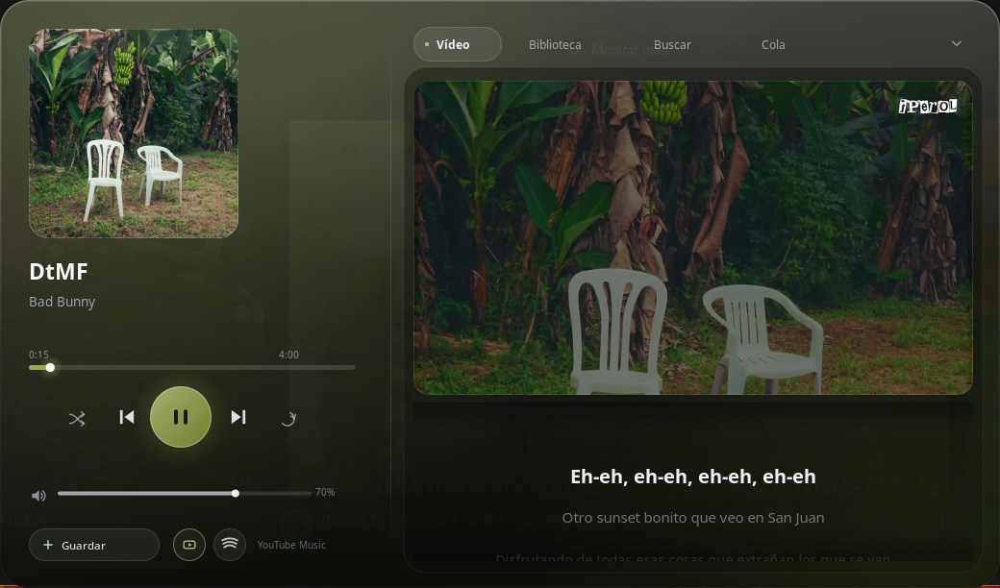
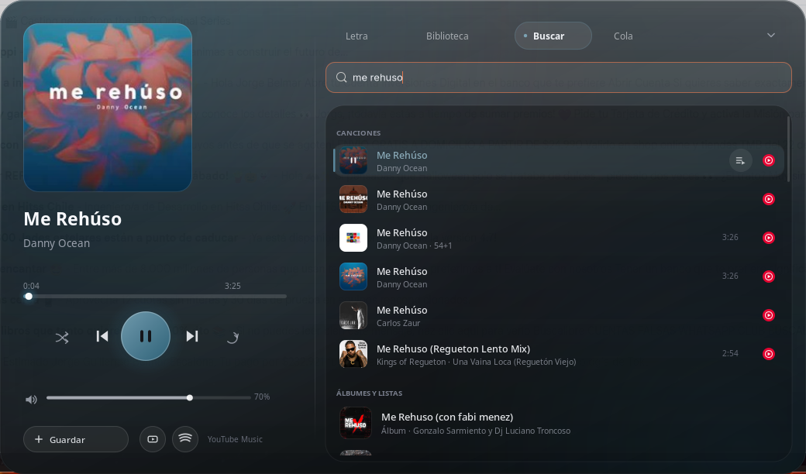

# Marmota Music

Reproductor de música nativo para Omarchy/Hyprland y Windows: una barra flotante tipo
*notch* en la parte inferior de la pantalla, con estética de vidrio, portada,
letras sincronizadas, vídeo dentro del notch y controles completos.
Busca y reproduce desde **YouTube Music** y **Spotify**.




- **Abrir/cerrar:** `Super + Shift + M` (en Windows `Win + Alt + M`), o `marmota-music toggle`
- **Instalar:** `./install.sh` (ver [Instalar](#instalar)); en Windows, `install.ps1` (ver [Windows](#windows))
- Hecho en Rust + GTK4, pensado para gastar poco: ~1 % de CPU contraído.

## Uso

| Acción | Cómo |
| --- | --- |
| Abrir el notch | `Super + Shift + M` |
| Reproducir / pausar | clic en el botón central, o `Espacio` |
| Adelantar / retroceder 5 s | `←` / `→` |
| Volumen | arrastrar la barra, rueda del ratón, o `↑` / `↓` |
| Encoger a la píldora mini | clic en el chevron, `Esc` |
| Letras / biblioteca / buscar / cola | pestañas de la derecha |
| Corregir una letra desfasada | clic derecho en la línea que está sonando, o `[` / `]` (±0,5 s); se recuerda por canción |
| Ver el videoclip dentro del notch | botón ▶▭ junto a *Guardar*, o `v` |
| Guardar en la biblioteca | botón *Guardar* |
| Crear lista | Biblioteca → *Nueva lista* |
| Conectar YouTube Music / Spotify | Biblioteca → *Cuentas* (ver [Conectar cuentas](#conectar-cuentas)) |
| Importar tus listas de YouTube Music | Biblioteca → *Importar de YouTube Music* (usa la sesión del navegador elegido en *Cuentas*) |
| Reproducir a continuación / quitar de la cola | botones que aparecen al pasar el ratón por una fila |

La píldora mini muestra la línea actual de la letra y la siguiente, además de
los controles y una línea de progreso en el borde superior.

El notch aparece siempre en el monitor que tiene el foco y se escala según su
altura lógica: 1040×612 en una pantalla 1440p, 832×490 en el panel del portátil
(1080p a 1.25×). Al cambiar de monitor se vuelve a mapear la superficie.

## Cómo está hecho

| Pieza | Implementación |
| --- | --- |
| Ventana | GTK4 + `gtk4-layer-shell` (capa overlay, anclada abajo) |
| Dibujo | Cairo + Pango, todo pintado a mano (vidrio, iconos, texto) |
| Audio y vídeo | libmpv embebido (render por software al notch) con IPC JSON por socket |
| Búsqueda / inicio / álbumes / listas / radio | API InnerTube de YouTube Music (`src/ytm.rs`); yt-dlp como respaldo y para listas privadas |
| Letras | LRCLIB (exacta y búsqueda) y NetEase de respaldo; solo se cachean las sincronizadas |
| Portadas | descargadas y cacheadas en `~/.cache/marmota-music/art/` |
| Biblioteca / listas | SQLite (`~/.local/share/marmota-music/marmota-music.db`) |
| Control externo | socket `$XDG_RUNTIME_DIR/marmota-music.sock` + CLI |

## CLI

```
marmota-music toggle | show | hide | collapse | daemon | quit
marmota-music status                 # JSON del estado actual
marmota-music play-pause | next | prev | video
marmota-music play <videoId> [--title T] [--artist A]
marmota-music search [texto]
```

## Integración con el escritorio

`install.sh` agrega a Hyprland el atajo, el arranque automático y la regla de
vidrio de la capa `marmota-music`.

Opcional, para la barra de Omarchy: `extras/omarchy-bar-button.sh` muestra la
canción actual (requiere `jq`). Cópialo a `~/.config/omarchy/bar/scripts/` y
agrégalo como módulo con `"onClick": "marmota-music toggle"`.

## Instalar

```bash
git clone https://github.com/JorgeBelmarEscalona/marmota-music
cd marmota-music
./install.sh
```

El instalador:

1. instala lo que falte (`gtk4`, `gtk4-layer-shell`, `mpv`, `yt-dlp`,
   `spotifyd`, `rust`) con una sola contraseña de sudo;
2. compila e instala `~/.local/bin/marmota-music`;
3. agrega a Hyprland el atajo `Super + Shift + M`, el arranque automático y
   la regla de vidrio (si ya existen, no toca nada);
4. arranca el notch;
5. **la primera vez** abre el asistente de cuentas. Si ya estaba configurado,
   lo omite.

### Conectar cuentas

Desde el propio notch, sin terminal (Linux y Windows): **Biblioteca →
Cuentas**.

- **YouTube Music:** *Iniciar sesión con Google* abre una ventana de Chrome,
  Edge, Chromium o Brave con un perfil propio de Marmota, en la página de
  inicio de sesión de Google. Inicia sesión y **cierra esa ventana** cuando
  veas YouTube Music. Es una ventana normal: Google no deja iniciar sesión en
  un navegador con depuración remota. Después el notch abre ese perfil sin
  ventana, con DevTools, solo para leer la sesión (así no le afecta el
  cifrado de cookies de Chrome en Windows), la guarda como
  `youtube-cookies.txt` en la carpeta de datos e importa tus listas y tus
  «Me gusta».
  *Desconectar* borra esa sesión y el perfil. Sin un navegador Chromium
  (por ejemplo, solo Firefox), la vista ofrece en su lugar usar la sesión del
  navegador instalado.
- **Spotify (búsqueda):** *Crear app en Spotify* abre el panel de
  desarrolladores; luego *Pegar Client ID y secret* pide ambas claves en el
  campo de texto (el secret se oculta) y las valida con una búsqueda de
  prueba.
- **Spotify (reproducción con Premium, solo Linux):** instalar `spotifyd`
  necesita `sudo`, así que ese paso abre el asistente en una terminal.

El asistente de terminal, `marmota-music setup`, hace lo mismo paso a paso:

- **YouTube Music:** ¿tienes cuenta? → elige el navegador donde tienes la
  sesión iniciada → importa tus listas y tus «Me gusta».
- **Spotify:** ¿tienes cuenta? → abre la página para crear la app de
  búsqueda y valida las claves → si es Premium, instala `spotifyd`, abre el
  inicio de sesión y lo deja arrancando solo.

Todo es opcional: sin cuentas se puede buscar y escuchar desde YouTube Music.
Para repetirlo: `marmota-music setup` o `./install.sh --setup`.

## Windows

```powershell
git clone https://github.com/JorgeBelmarEscalona/marmota-music
cd marmota-music
powershell -ExecutionPolicy Bypass -File install.ps1
```

El instalador:

1. instala [MSYS2](https://www.msys2.org) con `winget` si no está, y desde
   ahí GTK4, libmpv y Rust (entorno UCRT64); `yt-dlp` también con `winget`;
2. compila y deja el programa, con las DLL de GTK y mpv que necesita, en
   `%LOCALAPPDATA%\Programs\MarmotaMusic\bin\marmota-music.exe` (agregado al
   `PATH` del usuario);
3. crea el arranque automático (carpeta *Inicio*) y un acceso en el menú
   Inicio;
4. arranca el notch y, la primera vez, abre el asistente de cuentas.

Diferencias con Linux:

| | Linux (Hyprland) | Windows |
| --- | --- | --- |
| Atajo | `Super + Shift + M` | `Win + Alt + M`; se cambia con la clave `hotkey` del config (p. ej. `"Ctrl + Shift + P"`). Si otro programa ya registró ese atajo, el notch lo captura igual con un hook de teclado |
| Ventana | capa `gtk4-layer-shell` | ventana sin bordes, siempre encima, fuera de la barra de tareas, centrada sobre la barra de tareas del monitor donde está el puntero |
| Control externo | socket Unix | puerto TCP en `127.0.0.1` (anotado en `%TEMP%\marmota-music.port`) |
| IPC con mpv | socket Unix | *named pipe* `\\.\pipe\marmota-music-mpv` |
| Configuración | `~/.config/marmota-music/config.json` | `%APPDATA%\marmota-music\config.json` |
| Biblioteca / caché | `~/.local/share`, `~/.cache` | `%APPDATA%\marmota-music`, `%LOCALAPPDATA%\marmota-music` |
| Spotify | búsqueda + reproducción con spotifyd | solo búsqueda; las canciones suenan desde YouTube Music |

Para importar listas de YouTube Music, Firefox es el navegador más fiable en
Windows: Chrome, Edge y Brave cifran sus cookies y `yt-dlp` a veces no puede
leerlas.

Para compilar a mano: en una terminal *MSYS2 UCRT64*, `pacman -S
mingw-w64-ucrt-x86_64-{gtk4,mpv,rust,pkgconf,gcc}` y `cargo build --release`.

## Spotify

La búsqueda mezcla YouTube Music y Spotify y ordena por: título de la
canción → artista → si tiene vídeo → calidad de audio. Cada fila muestra el
ícono de su plataforma a la derecha.

1. **Buscar en Spotify:** crea una app gratuita en
   <https://developer.spotify.com/dashboard> (cualquier nombre; Redirect URI
   `http://127.0.0.1:8888/callback`, marca *Web API*). Copia el *Client ID* y el
   *Client secret* en `~/.config/marmota-music/config.json`
   (`spotify_client_id`, `spotify_client_secret`).
2. **Reproducir desde Spotify (Premium):** `install.sh` ya instala
   `spotifyd`; el asistente (`marmota-music setup spotify`) abre el inicio de
   sesión **una sola vez por equipo** y lo deja arrancando solo. Crea
   `~/.config/spotifyd/spotifyd.conf` (320 kbps, MPRIS en el bus de sesión). El notch reproduce cada canción con
   `OpenUri` por MPRIS y sigue con su propia cola.

Sin `spotifyd`, una canción de Spotify se reproduce igual: se busca la misma
canción en YouTube Music.

## Limitaciones conocidas

- **Spotify**: el vídeo y la radio automática vienen de YouTube Music.
- **Apple Music**: descartado (no hay reproducción viable en Linux).
- **Blur de fondo**: Hyprland 0.56 no aplica `layer_rule` con `blur` en esta
  instalación (no hay `hyprpm`, así que tampoco HyprGlass). El vidrio se pinta
  con opacidad propia y la portada desenfocada como textura.
- La superficie de capa no puede cambiar de monitor sin volver a mapearse: al
  abrir el notch en otro monitor se recrea (parpadeo mínimo, ~1 frame).
- El modo vídeo recarga la pista con un formato que incluye vídeo; si la pista
  no tiene vídeo, vuelve solo a audio en unos segundos.
