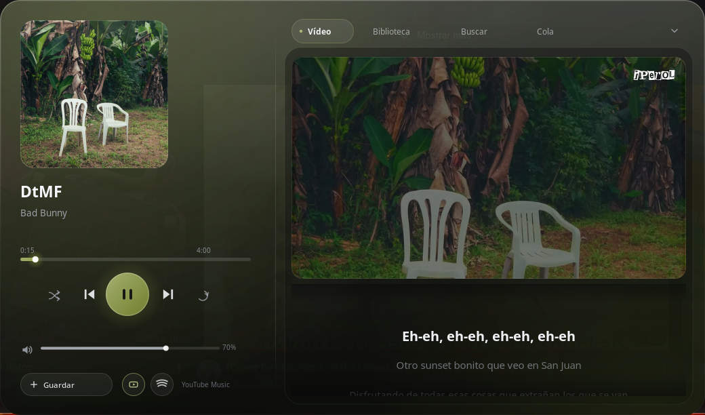
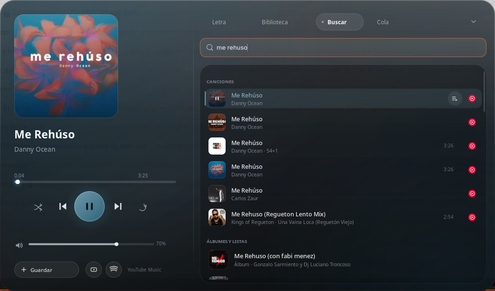

# Marmota Music

Reproductor de música nativo para Omarchy/Hyprland, macOS y Windows: una barra flotante tipo
*notch* en la parte inferior de la pantalla, con estética de vidrio, portada,
letras sincronizadas, vídeo dentro del notch y controles completos.
Busca y reproduce desde **YouTube Music**, **Spotify** y **Apple Music** (con tu suscripción en macOS).




- **Abrir/cerrar:** `Super + Shift + M` (en macOS `⌘ + ⇧ + M`, en Windows `Win + Alt + M`), o `marmota-music toggle`
- **Instalar:** [Linux](#linux-omarchy--hyprland) `./install.sh` · [macOS](#macos) `./install-mac.sh` · [Windows](#windows) `install.ps1`
- Hecho en Rust + GTK4, pensado para gastar poco: ~1 % de CPU contraído.

## Uso

| Acción | Cómo |
| --- | --- |
| Abrir el notch | `Super + Shift + M` (macOS `⌘ + ⇧ + M`, Windows `Win + Alt + M`) |
| Reproducir / pausar | clic en el botón central, o `Espacio` |
| Adelantar / retroceder 5 s | `←` / `→` |
| Volumen | arrastrar la barra, rueda del ratón, o `↑` / `↓` |
| Encoger a la píldora mini | clic en el chevron, `Esc` |
| Letras / biblioteca / buscar / cola | pestañas de la derecha |
| Corregir una letra desfasada | clic derecho en la línea que está sonando, o `[` / `]` (±0,5 s); se recuerda por canción |
| Ver el videoclip dentro del notch | botón ▶▭ junto a *Guardar*, o `v` |
| Guardar en la biblioteca | botón *Guardar* |
| Crear lista | Biblioteca → *Nueva lista* |
| Conectar YouTube Music / Spotify | Biblioteca → *Cuentas* (ver [Conectar cuentas](#conectar-cuentas)) |
| Importar tus listas de YouTube Music | Biblioteca → *Importar de YouTube Music* (usa la sesión del navegador elegido en *Cuentas*) |
| Reproducir a continuación / quitar de la cola | botones que aparecen al pasar el ratón por una fila |

La píldora mini muestra la línea actual de la letra y la siguiente, además de
los controles y una línea de progreso en el borde superior.

El notch aparece siempre en el monitor que tiene el foco y se escala según su
altura lógica: 1040×612 en una pantalla 1440p, 832×490 en el panel del portátil
(1080p a 1.25×). Al cambiar de monitor se vuelve a mapear la superficie.

## Cómo está hecho

| Pieza | Implementación |
| --- | --- |
| Ventana | GTK4 + `gtk4-layer-shell` (capa overlay, anclada abajo) |
| Dibujo | Cairo + Pango, todo pintado a mano (vidrio, iconos, texto) |
| Audio y vídeo | libmpv embebido (render por software al notch) con IPC JSON por socket |
| Búsqueda / inicio / álbumes / listas / radio | API InnerTube de YouTube Music (`src/ytm.rs`); yt-dlp como respaldo y para listas privadas |
| Búsqueda en Spotify / Apple Music | Spotify Web API (`src/spotify_api.rs`); Apple Music API con un token ES256 firmado con tu clave MusicKit (`src/apple_api.rs`) |
| Reproducción de Apple Music (macOS) | ayudante Swift con MusicKit `ApplicationMusicPlayer` (`macos/AppleMusicHelper`), JSON por stdin/stdout (`src/apple_music.rs`) |
| Letras | LRCLIB (exacta y búsqueda) y NetEase de respaldo; solo se cachean las sincronizadas |
| Portadas | descargadas y cacheadas en `~/.cache/marmota-music/art/` |
| Biblioteca / listas | SQLite (`~/.local/share/marmota-music/marmota-music.db`) |
| Control externo | socket `$XDG_RUNTIME_DIR/marmota-music.sock` + CLI |

## CLI

```
marmota-music toggle | show | hide | collapse | daemon | quit
marmota-music status                 # JSON del estado actual
marmota-music play-pause | next | prev | video
marmota-music play <videoId> [--title T] [--artist A]
marmota-music search [texto]
```

## Integración con el escritorio

`install.sh` agrega a Hyprland el atajo, el arranque automático y la regla de
vidrio de la capa `marmota-music`.

Opcional, para la barra de Omarchy: `extras/omarchy-bar-button.sh` muestra la
canción actual (requiere `jq`). Cópialo a `~/.config/omarchy/bar/scripts/` y
agrégalo como módulo con `"onClick": "marmota-music toggle"`.

## Instalar

| | Linux (Omarchy / Hyprland) | macOS | Windows |
| --- | --- | --- | --- |
| Requisitos | Arch / Omarchy con `pacman` y `git` | macOS 11 o superior, [Homebrew](https://brew.sh) y `git` | Windows 10/11 con `winget` y `git` |
| Instalador | `./install.sh` | `./install-mac.sh` | `install.ps1` |
| Atajo | `Super + Shift + M` | `⌘ + ⇧ + M` | `Win + Alt + M` |
| Queda en | `~/.local/bin/marmota-music` | `~/Applications/Marmota Music.app` | `%LOCALAPPDATA%\Programs\MarmotaMusic` |

Para **actualizar**, en la carpeta del proyecto: `git pull` y vuelve a
ejecutar el instalador. Lo que ya está configurado no se toca.

### Linux (Omarchy / Hyprland)

```bash
git clone https://github.com/JorgeBelmarEscalona/marmota-music
cd marmota-music
./install.sh
```

El instalador:

1. instala lo que falte (`gtk4`, `gtk4-layer-shell`, `mpv`, `yt-dlp`,
   `spotifyd`, `rust`) con una sola contraseña de sudo;
2. compila e instala `~/.local/bin/marmota-music`;
3. agrega a Hyprland el atajo `Super + Shift + M`, el arranque automático y
   la regla de vidrio (si ya existen, no toca nada);
4. arranca el notch;
5. **la primera vez** abre el asistente de cuentas. Si ya estaba configurado,
   lo omite.

Para repetir el asistente: `./install.sh --setup`.

### macOS

1. Abre la Terminal (⌘ + Espacio → «Terminal»). Si no tienes
   [Homebrew](https://brew.sh), instálalo:

   ```bash
   /bin/bash -c "$(curl -fsSL https://raw.githubusercontent.com/Homebrew/install/HEAD/install.sh)"
   ```

   `git` viene con las *Command Line Tools* de Xcode: si macOS ofrece
   instalarlas, acepta.

2. Descarga e instala Marmota Music:

   ```bash
   git clone https://github.com/JorgeBelmarEscalona/marmota-music
   cd marmota-music
   ./install-mac.sh
   ```

3. Abre el notch con **`⌘ + ⇧ + M`**. No tiene icono en el Dock: aparece
   sobre él.

El instalador:

1. instala con `brew` lo que falte (`gtk4`, `mpv`, `yt-dlp`, `pkgconf`,
   `adwaita-icon-theme`, `rust`);
2. compila y crea `~/Applications/Marmota Music.app` (sin icono en el Dock
   ni barra de menús propia), firmada *ad hoc*, y el comando
   `marmota-music` en `$(brew --prefix)/bin`;
3. registra un LaunchAgent (`~/Library/LaunchAgents/dev.marmota.music.plist`)
   para que arranque al iniciar sesión, y lo arranca;
4. **la primera vez** abre el asistente de cuentas.

Para repetir el asistente: `./install-mac.sh --setup`. Para desinstalar:

```bash
launchctl bootout gui/$(id -u)/dev.marmota.music
rm -rf ~/Applications/Marmota\ Music.app ~/Library/LaunchAgents/dev.marmota.music.plist "$(brew --prefix)/bin/marmota-music"
```

### Windows

1. Abre PowerShell. Si no tienes `git`, instálalo y abre una **nueva**
   ventana de PowerShell:

   ```powershell
   winget install --id Git.Git -e
   ```

2. Descarga e instala Marmota Music:

   ```powershell
   git clone https://github.com/JorgeBelmarEscalona/marmota-music
   cd marmota-music
   powershell -ExecutionPolicy Bypass -File install.ps1
   ```

3. Abre el notch con **`Win + Alt + M`**.

El instalador:

1. instala [MSYS2](https://www.msys2.org) con `winget` si no está, y desde
   ahí GTK4, libmpv y Rust (entorno UCRT64); `yt-dlp` también con `winget`;
2. compila y deja el programa, con las DLL de GTK y mpv que necesita, en
   `%LOCALAPPDATA%\Programs\MarmotaMusic\bin\marmota-music.exe` (agregado al
   `PATH` del usuario);
3. crea el arranque automático (carpeta *Inicio*) y un acceso en el menú
   Inicio;
4. arranca el notch y, **la primera vez**, abre el asistente de cuentas.

Para repetir el asistente:
`powershell -ExecutionPolicy Bypass -File install.ps1 -Setup`.

### Conectar cuentas

Desde el propio notch, sin terminal (Linux, macOS y Windows): **Biblioteca →
Cuentas**.

- **YouTube Music:** *Iniciar sesión con Google* abre una ventana de Chrome,
  Edge, Chromium o Brave con un perfil propio de Marmota, en la página de
  inicio de sesión de Google. Inicia sesión y **cierra esa ventana** cuando
  veas YouTube Music. Es una ventana normal: Google no deja iniciar sesión en
  un navegador con depuración remota. Después el notch abre ese perfil sin
  ventana, con DevTools, solo para leer la sesión (así no le afecta el
  cifrado de cookies de Chrome en Windows), la guarda como
  `youtube-cookies.txt` en la carpeta de datos e importa tus listas y tus
  «Me gusta».
  *Desconectar* borra esa sesión y el perfil. Sin un navegador Chromium
  (por ejemplo, solo Firefox), la vista ofrece en su lugar usar la sesión del
  navegador instalado.
- **Spotify (búsqueda):** *Crear app en Spotify* abre el panel de
  desarrolladores; luego *Pegar Client ID y secret* pide ambas claves en el
  campo de texto (el secret se oculta) y las valida con una búsqueda de
  prueba.
- **Spotify (reproducción con Premium, solo Linux):** instalar `spotifyd`
  necesita `sudo`, así que ese paso abre el asistente en una terminal.

- **Apple Music (búsqueda):** *Crear clave en Apple Developer* abre el
  portal y *Configurar clave* abre el asistente en una terminal (ver
  [Apple Music](#apple-music)).

El asistente de terminal, `marmota-music setup`, hace lo mismo paso a paso:

- **YouTube Music:** ¿tienes cuenta? → elige el navegador donde tienes la
  sesión iniciada → importa tus listas y tus «Me gusta».
- **Spotify:** ¿tienes cuenta? → abre la página para crear la app de
  búsqueda y valida las claves → si es Premium, instala `spotifyd`, abre el
  inicio de sesión y lo deja arrancando solo.
- **Apple Music:** ¿tienes Apple Developer? → Team ID, Key ID, archivo
  `.p8` y país → prueba una búsqueda → en macOS pide el acceso a Apple Music
  para reproducir con tu suscripción (`marmota-music setup apple` para solo
  este paso).

Todo es opcional: sin cuentas se puede buscar y escuchar desde YouTube Music.
Para repetirlo: `marmota-music setup` (o el instalador con `--setup` / `-Setup`).

## Diferencias en macOS

Es el mismo binario Rust + GTK4 con Cairo por CPU, así que gasta lo mismo
que en Linux. Diferencias con Linux:

| | Linux (Hyprland) | macOS |
| --- | --- | --- |
| Atajo | `Super + Shift + M` | `⌘ + ⇧ + M` (Carbon `RegisterEventHotKey`, no pide permiso de Accesibilidad); se cambia con la clave `hotkey` del config (p. ej. `"Ctrl + Option + P"`) |
| Ventana | capa `gtk4-layer-shell` | ventana sin bordes a nivel *status*, en todos los Escritorios y sobre apps a pantalla completa, fuera de ⌘Tab; centrada sobre el Dock de la pantalla donde está el puntero |
| Clics en la zona transparente | región de entrada | pasan a la ventana de atrás (`ignoresMouseEvents`, revisado ~20 veces por segundo solo mientras el notch está visible) |
| Control externo / IPC con mpv | socket Unix en `$XDG_RUNTIME_DIR` | socket Unix en la carpeta temporal del usuario (`/var/folders/…/T/`) |
| Configuración | `~/.config/marmota-music/config.json` | `~/Library/Application Support/marmota-music/config.json` |
| Biblioteca / caché | `~/.local/share`, `~/.cache` | `~/Library/Application Support`, `~/Library/Caches` |
| Spotify | búsqueda + reproducción con spotifyd | solo búsqueda; las canciones suenan desde YouTube Music |

Notas:

- **Iniciar sesión con Google:** en macOS cerrar la ventana no cierra el
  navegador; cuando veas YouTube Music, ciérralo con **⌘Q** para que el notch
  lea la sesión.
- **Usar la sesión de un navegador:** Safari necesita *Acceso total al disco*
  para la app que ejecuta `yt-dlp` (Ajustes del Sistema → Privacidad y
  seguridad); Chrome, Brave y Edge piden permiso al llavero la primera vez.
- Para compilar a mano: `brew install gtk4 mpv pkgconf` y
  `cargo build --release`. `build.rs` agrega la carpeta de `libmpv` de
  Homebrew al enlazador.

## Diferencias en Windows

| | Linux (Hyprland) | Windows |
| --- | --- | --- |
| Atajo | `Super + Shift + M` | `Win + Alt + M`; se cambia con la clave `hotkey` del config (p. ej. `"Ctrl + Shift + P"`). Si otro programa ya registró ese atajo, el notch lo captura igual con un hook de teclado |
| Ventana | capa `gtk4-layer-shell` | ventana sin bordes, siempre encima, fuera de la barra de tareas, centrada sobre la barra de tareas del monitor donde está el puntero |
| Control externo | socket Unix | puerto TCP en `127.0.0.1` (anotado en `%TEMP%\marmota-music.port`) |
| IPC con mpv | socket Unix | *named pipe* `\\.\pipe\marmota-music-mpv` |
| Configuración | `~/.config/marmota-music/config.json` | `%APPDATA%\marmota-music\config.json` |
| Biblioteca / caché | `~/.local/share`, `~/.cache` | `%APPDATA%\marmota-music`, `%LOCALAPPDATA%\marmota-music` |
| Spotify | búsqueda + reproducción con spotifyd | solo búsqueda; las canciones suenan desde YouTube Music |

Para importar listas de YouTube Music, Firefox es el navegador más fiable en
Windows: Chrome, Edge y Brave cifran sus cookies y `yt-dlp` a veces no puede
leerlas.

Para compilar a mano: en una terminal *MSYS2 UCRT64*, `pacman -S
mingw-w64-ucrt-x86_64-{gtk4,mpv,rust,pkgconf,gcc}` y `cargo build --release`.

## Spotify

La búsqueda mezcla YouTube Music y Spotify y ordena por: título de la
canción → artista → si tiene vídeo → calidad de audio. Cada fila muestra el
ícono de su plataforma a la derecha.

1. **Buscar en Spotify:** crea una app gratuita en
   <https://developer.spotify.com/dashboard> (cualquier nombre; Redirect URI
   `http://127.0.0.1:8888/callback`, marca *Web API*). Copia el *Client ID* y el
   *Client secret* en `~/.config/marmota-music/config.json`
   (`spotify_client_id`, `spotify_client_secret`).
2. **Reproducir desde Spotify (Premium):** `install.sh` ya instala
   `spotifyd`; el asistente (`marmota-music setup spotify`) abre el inicio de
   sesión **una sola vez por equipo** y lo deja arrancando solo. Crea
   `~/.config/spotifyd/spotifyd.conf` (320 kbps, MPRIS en el bus de sesión). El notch reproduce cada canción con
   `OpenUri` por MPRIS y sigue con su propia cola.

Sin `spotifyd`, una canción de Spotify se reproduce igual: se busca la misma
canción en YouTube Music.

## Apple Music

Busca en todo el catálogo de Apple Music junto con YouTube Music y Spotify.
Las filas de Apple Music llevan su ícono rojo y siguen el mismo orden
(título → artista → vídeo → calidad). Funciona en Linux, macOS y Windows.

Hace falta una cuenta de [Apple Developer](https://developer.apple.com/account)
(de pago), porque la API firma cada consulta con una clave MusicKit tuya:

1. *Certificates, IDs & Profiles* → **Identifiers** → **+** → **Media IDs**:
   descripción «Marmota Music», identificador `media.dev.marmota.music`,
   marca **MusicKit** y regístralo.
2. **Keys** → **+**: nombre «Marmota Music», marca **Media Services**, pulsa
   **Configure**, elige el Media ID anterior y registra la clave.
3. Descarga `AuthKey_XXXXXXXXXX.p8` (Apple deja descargarlo **una sola
   vez**) y anota el **Key ID**. El **Team ID** está en *Membership details*.
4. En el notch: **Biblioteca → Cuentas → Apple Music → Configurar clave**,
   o en una terminal `marmota-music setup apple`. Te pide el Team ID, el
   Key ID, el archivo `.p8` (puedes arrastrarlo a la ventana) y el país de
   tu cuenta, y prueba una búsqueda.

La clave se copia a la carpeta de datos (`apple-musickit.p8`, solo legible
por tu usuario) y el config guarda `apple_team_id`, `apple_key_id`,
`apple_key_file` y `apple_storefront`. No la subas a ningún repositorio:
con ella cualquiera puede usar la API a tu nombre. *Quitar clave* en
Cuentas la borra.

### Reproducir con tu suscripción (macOS 14 o posterior)

En macOS las canciones de Apple Music suenan con **tu suscripción**, a
través de un pequeño ayudante en Swift sin ventana (`macos/AppleMusicHelper`,
MusicKit `ApplicationMusicPlayer`). `install-mac.sh` lo compila y lo deja en
`Marmota Music.app/Contents/Helpers/Marmota Apple Music.app`. El notch le
manda play, pausa y salto por stdin y recibe posición, duración, estado y fin
de pista por stdout (cada 0,5 s con el notch abierto, cada 5 s oculto, y
nada en pausa).

MusicKit crea su propio token, pero solo para una app firmada por tu equipo
cuyo App ID tenga el servicio MusicKit. Hazlo una vez:

1. *Certificates, IDs & Profiles* → **Identifiers** → **+** → **App IDs** →
   **App**: descripción «Marmota Music Helper», Bundle ID **explícito**
   `dev.marmota.music.helper`; en la pestaña **App Services** marca
   **MusicKit** y regístralo.
2. Necesitas un certificado **Apple Development** (o **Developer ID
   Application**) de ese equipo en el llavero. Si no lo tienes: Xcode →
   *Settings* → *Accounts* → tu cuenta → *Manage Certificates* → **+**.
3. Configura la clave (pasos de arriba, para que el instalador sepa tu Team
   ID) y vuelve a ejecutar `./install-mac.sh`: firma el ayudante con el
   certificado de tu Team ID. Con otro certificado:
   `MARMOTA_SIGN_IDENTITY="Apple Development: …" ./install-mac.sh`; con otro
   Bundle ID: `MARMOTA_HELPER_ID=…`.
4. `marmota-music setup apple` pide a macOS el acceso a Apple Music (o lo pide
   la primera canción). Se puede cambiar en *Ajustes del Sistema →
   Privacidad y seguridad → Archivos multimedia y Apple Music*.

`marmota-music apple-test` muestra si el ayudante está instalado, el permiso
y si la suscripción puede reproducir el catálogo.

Si algo falla (sin ayudante, sin permiso, sin suscripción, App ID sin
MusicKit, macOS 13 o anterior, Linux y Windows), la canción suena buscando la
misma en YouTube Music, como antes, y la línea de estado dice por qué.

- **Volumen:** MusicKit no tiene volumen propio en el Mac; manda el del
  sistema.
- **Letra:** la misma cadena de siempre (LRCLIB → NetEase), sincronizada con
  la posición real de Apple Music. La API pública de Apple Music no documenta
  ningún endpoint de letras, así que el notch no las pide a Apple (tampoco usa
  el token del reproductor web de music.apple.com). Para ver qué responde Apple
  con tus claves: `marmota-music apple-test lyrics <id de catálogo>`.
- **Vídeo:** los videoclips de Apple Music llevan FairPlay y no se pueden
  pintar en el notch. Con el modo vídeo se muestra el videoclip de YouTube de
  la canción **sin sonido**, y cada 2 s se vuelve a alinear con la posición de
  Apple Music si se desvía más de 0,3 s. Si el clip tiene intro, la imagen
  puede no coincidir con la del vídeo original.
- **Radio:** cuando la cola se acaba, la radio sale de YouTube Music a partir
  de la canción gemela.

## Limitaciones conocidas

- **Spotify**: el vídeo y la radio automática vienen de YouTube Music.
- **Apple Music**: la reproducción con tu suscripción es solo para macOS 14+ con el ayudante firmado; en Linux, Windows o sin ayudante suena desde YouTube Music. Sin volumen propio ni letras de Apple (ver [Apple Music](#apple-music)).
- **macOS**: el vidrio no difumina lo que hay detrás (como en Hyprland, se
  pinta con opacidad propia y la portada desenfocada).
- **Blur de fondo**: Hyprland 0.56 no aplica `layer_rule` con `blur` en esta
  instalación (no hay `hyprpm`, así que tampoco HyprGlass). El vidrio se pinta
  con opacidad propia y la portada desenfocada como textura.
- La superficie de capa no puede cambiar de monitor sin volver a mapearse: al
  abrir el notch en otro monitor se recrea (parpadeo mínimo, ~1 frame).
- El modo vídeo recarga la pista con un formato que incluye vídeo; si la pista
  no tiene vídeo, vuelve solo a audio en unos segundos.
